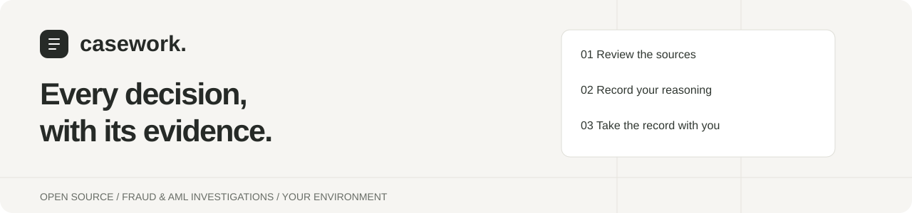
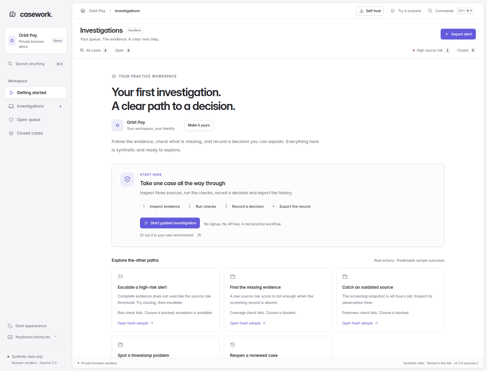
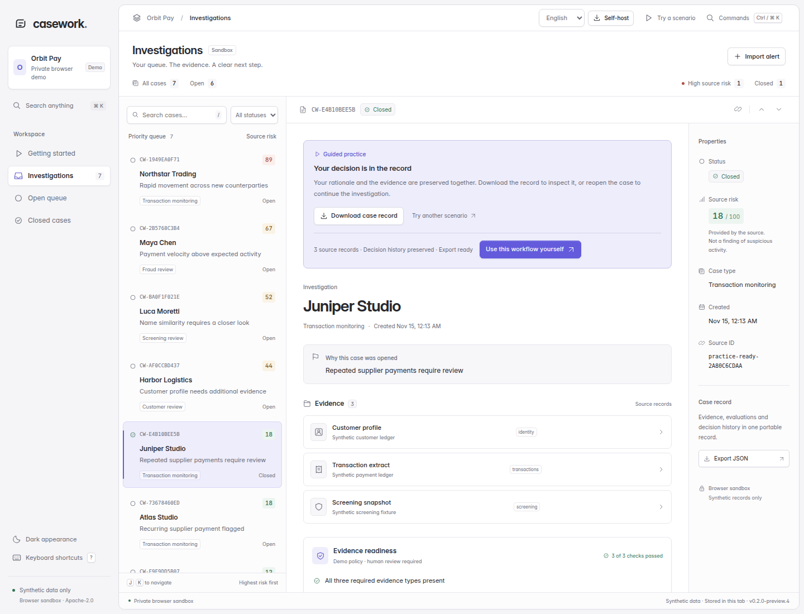

<div align="center">



### Open-source AML case management and fraud investigation

Start with a complete sample case. Keep the evidence, decision and history together.

**Apache-2.0** · **Developer preview** · **Python or Docker** · **No model key required**

[**Try the live demo →**](https://casework-live.sunshinevendetta.chatgpt.site) · [Download ZIP](https://github.com/anshuman-pandey/casework/archive/refs/heads/main.zip) · [Self-host](docs/self-hosting.md) · [Scenarios](docs/scenarios.md) · [Contribute](CONTRIBUTING.md)

</div>

> This is a working **single-user sandbox for synthetic data**. Model-backed agents, team authentication and enterprise operations are on the roadmap. Use synthetic data only. The Python server is for private evaluation; the public demo runs entirely in your browser.


## A complete investigation. No setup.

[**Open the practice workspace →**](https://casework-live.sunshinevendetta.chatgpt.site)

Start a guided case, inspect its sources, record your decision and download the evidence trail. Add your business name and logo if you like—no branding wizard stands between you and the workflow. No account or API key required.

Practice records stay in your browser session. The demo uses the same interface as the self-hosted app, with browser-local storage instead of SQLite. [Demo details and limits](docs/live-demo.md).

## Run it on your computer

**You need [Python 3.12 or newer](https://www.python.org/downloads/).** No Python packages, database installation or API key is required.

### Download and launch

1. [Download Casework ZIP](https://github.com/anshuman-pandey/casework/archive/refs/heads/main.zip).
2. **Extract the ZIP**. Open the extracted folder containing `start.py` and `README.md`.
3. **Windows:** double-click `Start-Casework.cmd`. **macOS:** double-click `Start-Casework.command`. If macOS blocks it or Linux opens it as text, use the terminal instructions below.

Your browser opens automatically. Choose **Start guided investigation**. Keep the terminal window open while using Casework; press **Ctrl+C** in that window to stop. Each launch creates disposable sample data. Export any case records you want to keep.

<details>
<summary><strong>Using Terminal? No need to type a folder path.</strong></summary>

**macOS / Linux:** open Terminal, type `python3` followed by a space, then drag **start.py** from the extracted folder into Terminal. Press **Enter**.

**Windows:** open PowerShell, type `py -3` followed by a space, then drag **start.py** from File Explorer into PowerShell. Press **Enter**. If dragging is unavailable, right-click the file → **Copy as path**, then paste it after `py -3 `.

The result should look like one of these examples. Your actual folder name may differ. Keep the quotes when the path contains spaces:

```sh
python3 "/Users/you/Downloads/casework-main/start.py"
```

```powershell
py -3 "C:\Users\you\Downloads\casework-main\start.py"
```

The launcher finds the project itself; you do **not** need `cd`. It selects a free port and prints the browser URL. To keep records across restarts, append `--keep`; records are saved in `casework.db` beside `start.py`. To avoid opening the browser, append `--no-browser`.

</details>

<details>
<summary><strong>Already have Git and Python? Copy one command.</strong></summary>

Run from any terminal folder. The first run downloads source into a new `casework` folder in your home directory and launches it. It does not install Python or overwrite an existing folder.

**macOS / Linux**

```sh
git clone https://github.com/anshuman-pandey/casework.git "$HOME/casework" && python3 "$HOME/casework/start.py"
```

**Windows PowerShell**

```powershell
git clone https://github.com/anshuman-pandey/casework.git "$HOME/casework"; if ($LASTEXITCODE -eq 0) { py -3 "$HOME/casework/start.py" }
```

**Next time:** run `python3 "$HOME/casework/start.py"` (macOS/Linux) or `py -3 "$HOME/casework/start.py"` (PowerShell). Append `--keep` for persistent records. If that folder already exists, use this launch command for your existing Casework checkout, or use the ZIP path above for a separate copy.

</details>

Your first investigation: **open the sample → Record a decision → Tab to accept the complete sample rationale → Record decision**. Checks run automatically. Inspect evidence or edit the rationale whenever you want; download the record after saving. Reopen the case to see that its earlier history remains.



## Prefer Docker?

From the repository folder, with Docker Engine/Desktop and **Compose v2.20+**:

```sh
docker compose up -d --build --wait
```

Open **http://127.0.0.1:8080**. The database lives in a named Docker volume and survives container recreation. `docker compose down` stops the app and keeps the data. No Python installation is needed on your host.

[Self-hosting guide](docs/self-hosting.md): prerequisites, another port, a private server over SSH, persistence, backup, troubleshooting and production requirements. The application port is published to **127.0.0.1 only**.

## Sample data that teaches the workflow

Six investigations are preloaded. **Getting started** also creates fresh, independent scenarios whenever you need them; it never resets your existing work.

| Scenario | What you can verify |
|---|---|
| Your first investigation | Inspect → evaluate → close with rationale → export → reopen |
| High source risk | Complete evidence still cannot bypass the risk gate; escalate instead |
| Missing evidence | Low risk does not substitute for the missing screening record |
| Stale evidence | A 48-hour-old source fails the 24-hour freshness check |
| Future evidence | A timestamp one hour ahead fails the same freshness check |
| Reviewed history | Reopen a closed fixture; prior decisions remain and another closure needs a new evaluation |

These cover the **implemented workflow**, including blocked paths. They do not simulate an AI agent, a sanctions provider or a regulatory filing system. [Scenario walkthroughs](docs/scenarios.md) include expected outcomes and developer replay tests.

## Designed for daily work

Notion and Linear are our explicit quality references: a readable case document, quiet navigation, consistent controls and fast keyboard interaction. [Our design standard](docs/design.md) links the primary research and the rules we apply.

Use **Ctrl/Cmd+K** for cases and commands, **/** for queue search, and **J/K** for case navigation. Copy case links, use browser Back/Forward, inspect evidence without losing expansion state, and keep rationale drafts during the session. Dark appearance is the default; your light/dark choice is remembered locally. Fonts and icons are bundled; the application does not call a CDN or send telemetry.



[Dark appearance](docs/assets/demo-dark.png) · [Mobile layout](docs/assets/demo-mobile.png) · [Command menu](docs/assets/commands.png)

## What works, and what comes next

| Available in this preview | Still to build |
|---|---|
| Public browser demo, optional branding, Python and Docker setup | Authenticated teams, RBAC, SSO and tenant isolation |
| Cases, evidence, search and status filters over the first 500 cases | Paginated search, saved views, SLAs and assignment |
| JSON ingestion with idempotent source IDs | CSV migration, connectors and reconciliation |
| Deterministic, versioned policy evaluation | Model-backed investigation with cited findings |
| Close, escalate and reopen with rationale | Governed autonomous resolution and external actions |
| Atomic decisions and application event history | Independent audit integrity, retention and legal holds |
| Portable JSON case exports | Regulatory filing packs and managed attachments |
| Browser workflow checks and container recovery checks | Enterprise load testing and a full accessibility audit |

The original code is **Apache-2.0**, with no feature keys or per-seat limits. Security and enterprise controls belong in the free distribution when implemented. Infrastructure, licensed datasets and optional model inference can still cost money. “Casework” remains a provisional product name.

## Bring in a synthetic alert

**Import alert** turns a monitoring-system alert into a case with its source records and decision history. Pick an editable sample for repeated payments, high source risk, or missing screening evidence. The sample uses your workspace name. In the public demo, imports stay in your browser; self-hosted API imports are stored in SQLite. There is no automatic vendor connector yet.

Generate a complete alert with fresh timestamps, save it once, and send it to the running app:

```sh
python3 -m casework.demo ready > sample-alert.json
curl http://127.0.0.1:8080/api/alerts \
  -H 'Content-Type: application/json' \
  --data-binary @sample-alert.json
```

Replay the same file and the original case ID is returned. Reuse that source ID with changed content and the API returns `409`. The static [minimal example](examples/alert.json) intentionally contains no evidence, so it imports but cannot close. [API contract →](docs/api.md) · [Tested n8n import workflow →](examples/n8n/README.md)

To exercise every scenario and the import/replay path against a running sandbox:

```sh
python3 -m casework.verify
```

This adds seven synthetic cases and checks **34 outcomes**. It does not modify pre-existing cases. Inside Docker, use `docker compose exec casework python3 -m casework.verify` (add `--url` when using a different port).

## Build with us

[Contributor guide](CONTRIBUTING.md) · [First-run feedback](https://github.com/anshuman-pandey/casework/issues/new?template=first_run.yml) · [Security](SECURITY.md)

| Read next | Why |
|---|---|
| [Adoption requirements](docs/adoption.md) | First-value goals, user constraints and an uncoached review protocol |
| [Competitive research](docs/research/landscape.md) | Verafin, Unit21, Oscilar and adjacent alternatives; evidence versus hypotheses |
| [Product blueprint](docs/product.md) | User journeys, automation authority and release gates |
| [Architecture](docs/architecture.md) | Current implementation and production decisions |
| [Validation](docs/validation.md) | What was actually tested and what remains unverified |

```sh
python3 -m unittest discover -s tests -v
```

Python's standard library and SQLite keep the sandbox easy to evaluate. Node is only needed for optional browser checks. [Inter is separately licensed](THIRD_PARTY_NOTICES.md) under the SIL Open Font License.

---

[Apache-2.0](LICENSE) · Copyright 2026 Casework contributors.
