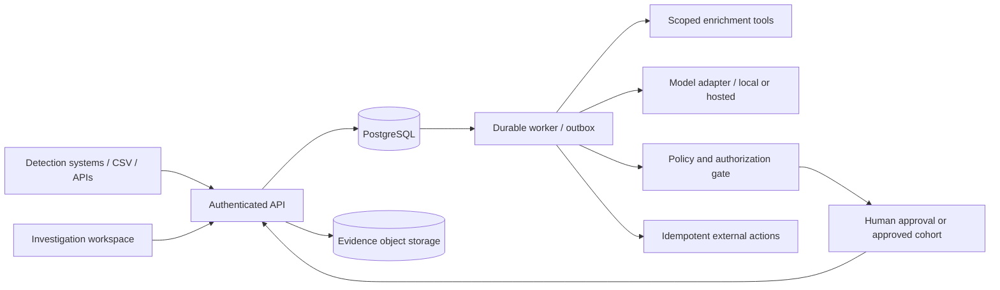

# Small core. Explicit boundaries.

[← Project](../README.md) · [Product blueprint](product.md)

## What exists today

A dependency-free Python 3.12+ local application serves a static interface and JSON endpoints. SQLite persists synthetic cases, evidence, policy evaluations and decision events. Native startup binds to loopback. The Docker image binds inside the container; Compose publishes only host loopback. Each mutation and its audit event commit together. Decision requests include the expected case version to prevent stale writes. An ingestion key is unique and retries with changed content are rejected.

This is a reference workflow, not the chosen enterprise server stack. Python's standard-library HTTP server and single-user SQLite are intentionally limited to local evaluation. No identity, tenancy, external model, durable agent worker or attachment storage is implemented. The event log is application-level history, not tamper-proof storage.

## Proposed production architecture

Begin as a modular monolith with an independently scalable worker. PostgreSQL handles transactions, indexed fields, JSONB extensions and initial search. A transactional outbox bridges committed state and external actions. Use object storage for large evidence with checksums and retention metadata. Introduce a search cluster or graph engine only when query measurements justify their operational cost.

### Data and execution contracts

| Object | Invariant |
|---|---|
| Tenant / membership | Identity and scope derive from authenticated credentials, never a caller-supplied tenant header alone |
| Alert | Unique `(tenant, source, external_id)`; store payload hash; altered replay is a conflict |
| Case / subject links | Case version advances atomically; links preserve relationship provenance |
| Evidence snapshot | Capture time, source time, content hash, permissions, retention and retrieval status |
| Decision | Actor, reason, disposition, case version, policy and evidence references committed together |
| Agent run | Immutable input snapshot; durable step states; bounded retries; actual tool/model output retained |
| Action / outbox | Stable idempotency key, attempt history, acknowledgement, reconciliation and compensation strategy |
| Audit event | Append-only application role; restricted administration; external retention/signing needed for stronger tamper evidence |

Authorization applies to list, search, detail, attachments, exports, background workers and model retrieval. PostgreSQL row-level security can add defense in depth; tenant context must reset safely between pooled connections. Negative isolation tests belong in every route and worker suite. Audit exports must obey the same permissions as the underlying evidence.

### Failure behavior

A committed action request is not an executed action. Expose pending, running, succeeded, failed and uncertain states. Use at-least-once delivery with idempotent consumers; don't promise exactly-once network effects. A timeout after sending an action requires reconciliation before retrying. Worker leases expire; crashed work resumes from a persisted step. Partial batch failures remain visible per item.

Data/model providers can be unavailable, rate-limited or return malformed data. Mark evidence incomplete and escalate; don't turn an enrichment failure into a clean result. Evidence changes invalidate a stale pending recommendation. Schema and workflow changes have migration plans and reversible activation, not silent edits to historical records.

## Performance plan

Employee count is not a load specification. Collect active investigators, alerts/day, cases/day, evidence size, search shape, retention, burstiness and regional boundaries. Use cursor pagination and bounded queries; retain transactions as references plus relevant snapshots instead of copying a data warehouse into every case.

**Proposed targets, not achieved results:** p95 queue/detail API latency below 300 ms at 100 concurrent investigators on an explicitly published topology with one million cases; successful ingestion sustained at 100 alerts/s with burst buffering; usable initial page below two seconds on the stated test network. Revise targets with design partners. Report server latency separately from browser rendering and external model latency.

Benchmark datasets must contain realistic evidence size, field cardinality, tenant skew and permission filters. Publish command, commit, hardware, database size, warm/cold state, concurrency, duration, p50/p95/p99, errors, CPU/memory and query plans. Test slow consumers, concurrent decisions, worker failures, backlog recovery and exports while interactive traffic runs. The included prototype has correctness tests, not enterprise benchmarks.

## Deployment and maintenance

Local demo: one Python process and a SQLite file. Production alpha target: application, worker, PostgreSQL and object storage with documented backups. A small team should not need Kubernetes. Enterprise deployment may add replicas, private inference and regional instances; the feature set stays the same.

Before production: authenticated identity; TLS; secrets management; rate/size limits; CSRF/session handling; dependency and image scanning; durable migrations; least-privilege storage; encrypted backups; restore drills; audit retention; telemetry with sensitive-field redaction; and a documented incident contact. This list is an implementation gate, not a claim of certification.

Database backups require consistency guarantees and restore verification. For the local SQLite demo, stop the server before copying the database, or use SQLite's backup API. Copying the main file while WAL writes continue is not a reliable backup procedure.

## Open decisions

- Production language/framework: compare a typed Python service against Go based on contributor fit, workers and operating profile; do not let the prototype accidentally settle this.
- Authentication: standard OIDC provider integration plus a simple supported small-team path; no mandatory vendor identity service.
- Tenant topology: shared schema with isolation tests versus separate databases for regulated boundaries.
- Agent orchestration: start with durable typed jobs; adopt an orchestration framework only if it improves recovery and operations.
- Reporting packs: prioritize one jurisdiction; require domain review and current schema validation before submission support.
